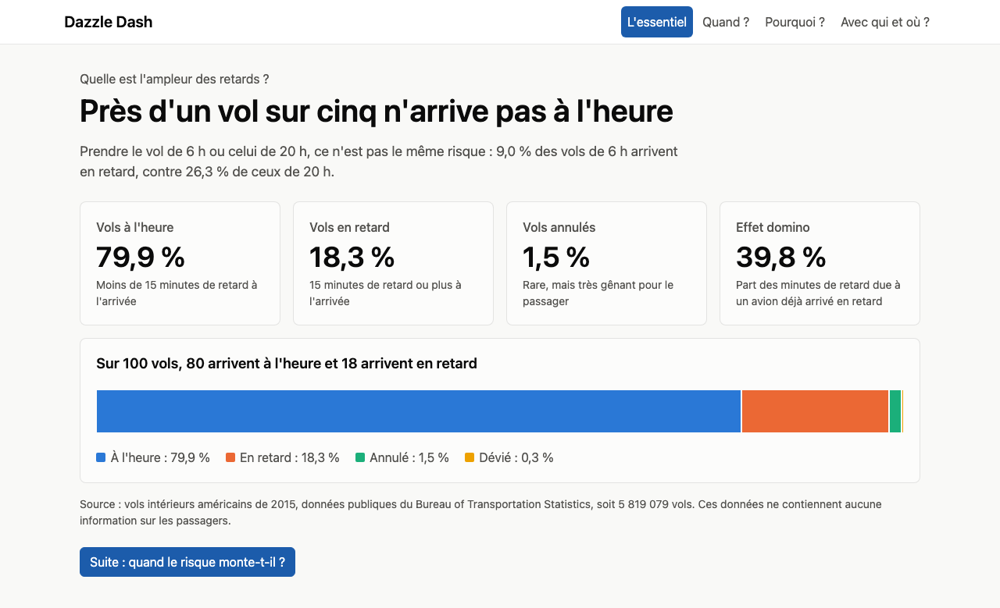
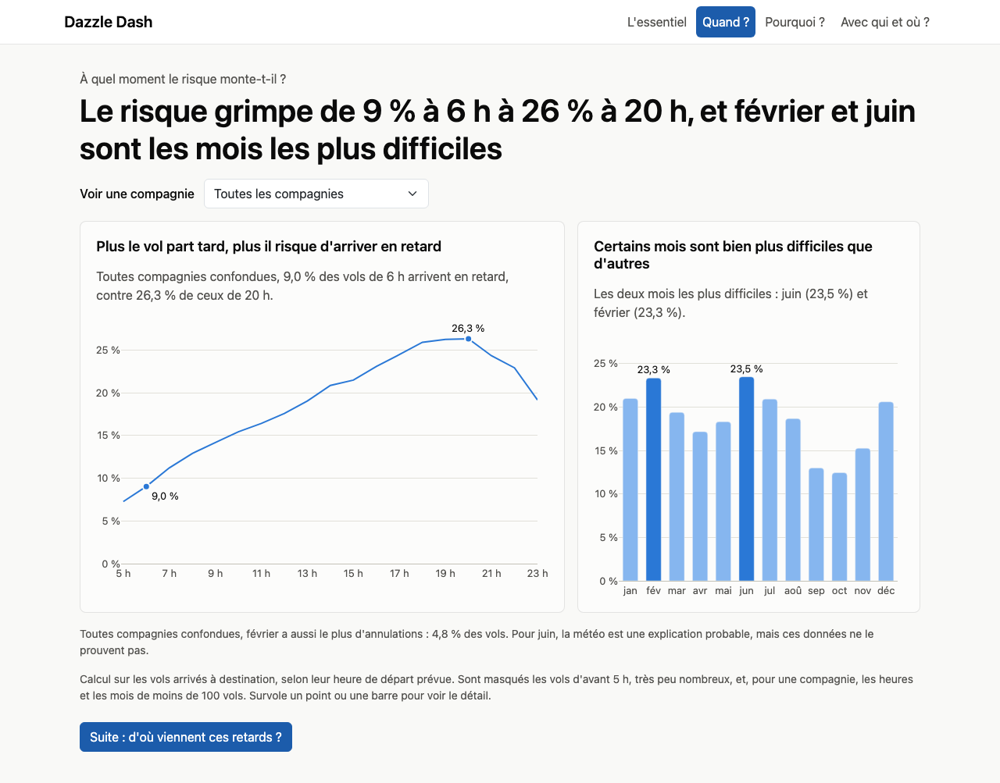
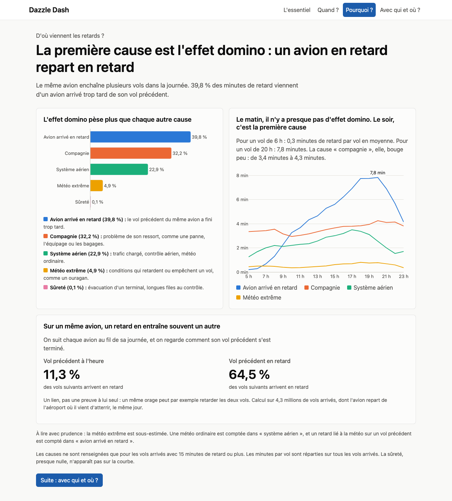
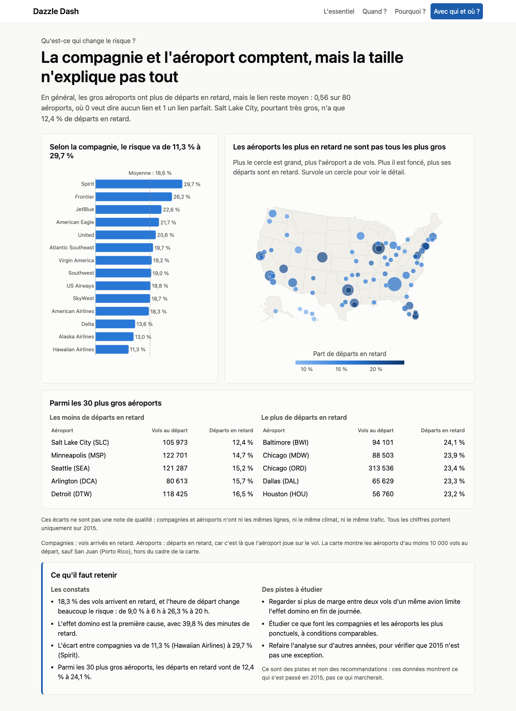

# Dazzle Dash

Une application web qui explique à un directeur, sans jargon, quand et pourquoi les vols intérieurs américains ont été en retard en 2015.



## Le data storytelling

Le data storytelling consiste à transmettre un message tiré des données à un public précis, en combinant données, visuels et récit, pour qu'il comprenne sans avoir à chercher ce qu'il faut en conclure.

**Exemple : Spotify Wrapped.** Plutôt que d'envoyer un tableau de toutes les écoutes, Spotify choisit quelques chiffres (artiste préféré, minutes d'écoute) et les présente une carte après l'autre, comme un petit récit. Aucune compétence n'est nécessaire pour comprendre.

## L'outil : Dash

[Dash](https://dash.plotly.com/) est une bibliothèque Python qui crée des applications web avec des graphiques interactifs, sans écrire de JavaScript.

Il repose sur deux idées :

- **La mise en page** décrit ce qui s'affiche : titres, graphiques, menus.
- **Les callbacks** décrivent ce qui change : quand on choisit une compagnie dans le menu, Dash appelle une fonction Python qui renvoie les nouveaux graphiques.

Je l'ai choisi car toute l'analyse est déjà en Python et qu'un lecteur peut explorer les graphiques dans son navigateur, sans rien installer.

## Le contexte

Un directeur veut comprendre les retards aériens sans avoir à lire des tableaux. L'application répond donc à quatre questions, une par page, dans l'ordre d'un récit :

| Page | Question | Message |
|---|---|---|
| L'essentiel | Quelle est l'ampleur des retards ? | Près d'un vol sur cinq n'arrive pas à l'heure |
| Quand ? | À quel moment le risque monte-t-il ? | Le risque grimpe de 9 % à 6 h à 26 % à 20 h |
| Pourquoi ? | D'où viennent les retards ? | La première cause est l'effet domino |
| Avec qui et où ? | Qu'est-ce qui change le risque ? | La compagnie et l'aéroport comptent, mais la taille n'explique pas tout |

## Les données

**Source :** [2015 Flight Delays and Cancellations](https://www.kaggle.com/datasets/usdot/flight-delays), publié sur Kaggle à partir des chiffres du Bureau of Transportation Statistics (BTS), l'organisme public américain des statistiques de transport.

**Contenu :** 5 819 079 vols intérieurs de 2015, avec leurs horaires, leur compagnie, leurs aéroports, leurs retards et leurs annulations. S'y ajoutent une liste de compagnies et une liste d'aéroports.

**Définition :** un vol est « en retard » s'il arrive avec 15 minutes de retard ou plus. C'est le seuil utilisé dans les données : les causes du retard ne sont renseignées qu'à partir de là.

### Le nettoyage

Aucune ligne n'a été supprimée. Le détail de chaque vérification est dans le [notebook](notebooks/eda_flights.ipynb).

| Problème trouvé | Ce que j'ai fait |
|---|---|
| Les vols annulés n'ont pas toujours de retard | Cases laissées vides : remplacer par 0 ferait croire que ces vols sont à l'heure |
| Les causes sont vides pour les petits retards | Parts de causes calculées uniquement sur les vols concernés |
| En octobre, les aéroports ont des codes à 5 chiffres au lieu de 3 lettres (8,4 % des données) | Codes traduits avec deux tables du BTS, puis contrôlés avec les distances des routes |
| 3 aéroports n'ont pas de coordonnées (10 020 vols, 0,17 %) | Vols gardés dans les chiffres, absents de la carte seulement |

### La vie privée (RGPD)

Les données ne contiennent aucune information sur les passagers. Elles contiennent l'immatriculation des avions, mais elle ne sert qu'à la préparation des données et n'arrive jamais dans l'application, qui n'utilise que des totaux.

## Les résultats

### Près d'un vol sur cinq n'arrive pas à l'heure

Sur 100 vols, environ 80 arrivent à l'heure (79,9 %), 18 en retard (18,3 %), moins de 2 sont annulés (1,5 %) et presque aucun n'est dévié (0,3 %).

### Le risque monte au fil de la journée

Le risque de retard passe de 9,0 % pour un départ prévu à 6 h à 26,3 % pour un départ prévu à 20 h. Juin (23,5 %) et février (23,3 %) sont les mois les plus difficiles, octobre le plus calme (12,4 %).

Février est aussi le mois le plus annulé (4,8 % des vols). La météo est une explication probable pour juin, mais ces données ne suffisent pas à le prouver.



### La première cause est l'effet domino

Le même avion enchaîne plusieurs vols dans la journée. S'il arrive en retard, il repart souvent en retard.

| Cause | Part des minutes de retard |
|---|---|
| Avion arrivé en retard | 39,8 % |
| Compagnie | 32,2 % |
| Système aérien | 22,9 % |
| Météo extrême | 4,9 % |
| Sûreté | 0,1 % |

Cet effet est presque absent le matin (0,3 minute par vol à 6 h) et devient la première cause le soir (7,8 minutes à 20 h).

Sur un même avion, 11,3 % des vols arrivent en retard quand le vol précédent était à l'heure, contre 64,5 % quand il était en retard. C'est un lien, pas une preuve : un même orage peut retarder les deux vols.

**Attention :** la part de la météo est sous-estimée. La météo ordinaire est comptée dans « système aérien », et un retard lié à la météo sur un vol précédent est compté dans « avion arrivé en retard ».



### La compagnie et l'aéroport comptent, mais la taille n'explique pas tout

- **Compagnies :** de 11,3 % de vols en retard chez Hawaiian Airlines à 29,7 % chez Spirit.
- **Aéroports :** parmi les 30 plus gros, de 12,4 % de départs en retard à Salt Lake City à 24,1 % à Baltimore.
- **Taille :** les gros aéroports ont en général plus de départs en retard, mais le lien reste moyen (0,56 sur une échelle où 0 veut dire aucun lien et 1 un lien parfait).

Ces écarts ne sont pas une note de qualité : compagnies et aéroports n'ont ni les mêmes lignes, ni le même climat, ni le même trafic.



### Ce que ces résultats ne disent pas

Les données montrent ce qui s'est passé en 2015, pas ce qu'il faudrait faire. D'où trois pistes à étudier, qui ne sont pas des recommandations :

- regarder si plus de marge entre deux vols d'un même avion limite l'effet domino en fin de journée ;
- étudier ce que font les compagnies et les aéroports les plus ponctuels, à conditions comparables ;
- refaire l'analyse sur d'autres années, pour vérifier que 2015 n'était pas une exception.

## Lancer le projet

Il faut [uv](https://docs.astral.sh/uv/), qui installe Python et les dépendances du projet.

### L'application

Les petits fichiers dont elle a besoin sont déjà dans le dépôt, le téléchargement des données n'est donc pas nécessaire.

```bash
git clone https://github.com/rovenmelloul/dazzle-dash.git
```

```bash
cd dazzle-dash
```

```bash
uv sync
```

```bash
uv run python index.py
```

Ouvrir ensuite <http://127.0.0.1:8050>. Une connexion internet est nécessaire pour le style (Bootstrap) et le fond de la carte.

### Le notebook et la préparation des données

Ces deux parties lisent les données complètes, trop lourdes pour le dépôt. Placer ces fichiers dans `data/raw/` :

- `flights.csv`, `airlines.csv` et `airports.csv`, depuis [Kaggle](https://www.kaggle.com/datasets/usdot/flight-delays) ;
- [`L_AIRPORT.csv`](https://www.transtats.bts.gov/Download_Lookup.asp?Y11x72=Y_NVecbeg) et [`L_AIRPORT_ID.csv`](https://www.transtats.bts.gov/Download_Lookup.asp?Y11x72=Y_NVecbeg_VQ), depuis le BTS.

Pour ouvrir le notebook :

```bash
uv run jupyter lab notebooks/eda_flights.ipynb
```

Pour recréer les petits fichiers de l'application :

```bash
uv run python scripts/prepare_data.py
```

## L'organisation du code

```text
index.py                     point d'entrée : choisit la page et lance le serveur
app.py                       crée l'application Dash
layout.py                    contenu des pages
callbacks.py                 réactions au filtre par compagnie
figures.py                   construction des graphiques
data.py                      chargement des données et calcul des chiffres
assets/style.css             style de l'application
scripts/prepare_data.py      transforme les données brutes en petits fichiers
data/processed/              petits fichiers lus par l'application
notebooks/eda_flights.ipynb  exploration et nettoyage des données
```

Chaque fichier a un seul rôle : on sait où aller pour modifier un texte (`layout.py`), un graphique (`figures.py`) ou un calcul (`data.py`).

L'application lit des nombres de vols, et non des pourcentages déjà calculés : on ne peut pas faire la moyenne de pourcentages, et il faut pouvoir les recalculer quand on filtre par compagnie.
